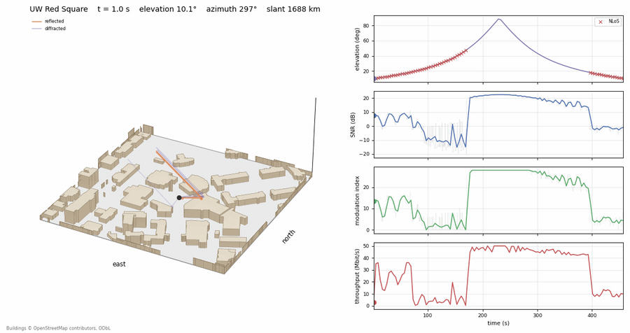

# ns-3-NTN

**ns-3-NTN** is an open-source, full-stack system-level simulator for 5G Non-Terrestrial Networks (NTN). It integrates [**5G-LENA**](https://5g-lena.cttc.es/), the ns-3 LEO orbit models and [**3GPP NTN channel models**](https://www.nsnam.org/doxygen/d7/d09/three-gpp-ntn-channel-example_8cc_source.html) to connect realistic LEO orbital dynamics and time-varying satellite channels with the complete 5G NR PHY/MAC and higher-layer protocol stack.

Unlike conventional link-level or network-level simulations in isolation, ns-3-NTN models the complete cross-layer chain: **orbit geometry → slant range/elevation → channel conditions and propagation delay → PHY SINR/BLER → link adaptation, HARQ, scheduling, and higher-layer performance**. It supports both **regenerative** and **transparent bent-pipe** satellite architectures and produces time-resolved traces such as satellite trajectory, SINR, MCS, HARQ behavior, TBLER, throughput, and latency.

This enables system-level investigation of NTN-specific problems—particularly how **elevation-dependent channel quality and long, time-varying RTT interact with 5G control loops and protocols**—that cannot be captured accurately by treating the satellite link or the 5G network independently.

New features are released in ns-3-NTN first and, where appropriate, upstreamed to the
mainline ns-3 and 5G-LENA projects. ns-3-NTN will continue to provide NTN-specific simulation
harnesses, tools, examples, and experimental features, serving as the primary development
and testing platform for new NTN functionality.

## Example: a ray-traced LEO pass

`leo-link-regen-RT` replaces the statistical channel with Sionna RT ray tracing over a scene
of the University of Washington campus: 178 buildings from OpenStreetMap around Red Square.
The satellite passes directly overhead, 10° → 90° → 10°, and the line of sight sweeps across
the buildings while the link adapts.

| parameter | value |
|---|---|
| Orbit | one satellite, 500 km, 53° inclination |
| Pass | directly over Red Square, southbound, 10° → 90° → 10°, 461 s |
| Carrier / bandwidth | 2 GHz / 30 MHz, TR 38.821 study case 9 |
| Channel | Sionna RT, up to 2 bounces (direct, reflected, through-wall, diffracted), updated every 1 s |
| Satellite antenna | one element per polarisation; the spot beam's gain is inside the EIRP |
| Link budget | satellite 30 dBi at 34 dBW/MHz, handheld with two ±45° ports |
| HARQ | 32 processes, retransmissions on |
| Traffic | 40 Mbps UDP |



This and the other examples (link-budget pre-check, a transparent pass, a regenerative pass
with four UEs, the beam edge, RR / PF / MR scheduling for ten UEs, ILLA vs OLLA link adaptation,
and RLC ARQ), and how to run them: **[`ntn/README.md`](ntn/README.md)**.
Figure provenance, including the exact run and render commands:
**[`ntn/figures/README.md`](ntn/figures/README.md)**.

## What's new in v1.1

- **Platform:** ns-3.45 + 5G-LENA v4.1 → **ns-3.48 + 5G-LENA v5.1**, shipped as a patch kit
  for the two upstream releases.
- **FDD:** both statistical-channel examples run a paired FDD carrier, as every 3GPP NR NTN
  band does except NB-IoT.
- **Two examples:** `leo-link` runs either payload, `--payload=transparent` (the default) or
  `regenerative`, and `leo-link-regen-RT` runs the regenerative link over a Sionna RT
  ray-traced channel.
- **Several UEs per run:** every satellite carries a gNB, each UE attaches to the closest one,
  and the uplinks of UEs at different ranges line up at the gNB.
- **Link budget tied to TR 38.821:** `--ntnPreset` selects a study case with its Set-1
  satellite, and study case 9 (LEO-600, S-band handheld) is the default. The simulated median
  DL SINR at 30° is 9.3–9.4 dB against the 9.6 dB the study case implies.
- **NTN timing:** cell-specific K_offset, geometry-derived timing advance, random access
  through the real propagation delay, and RRC timers sized for the round trip.
- **Link adaptation and HARQ:** downlink outer-loop link adaptation, Rel-17 HARQ feedback
  disabled, a finite HARQ soft buffer and a HARQ process timeout of its own.
- **Channel fixes:** a moving satellite no longer overlaps consecutive receptions, the
  Sionna RT channel model maps paths, elements, Doppler and carrier phase correctly, and a
  signal is beamformed with the beam it was sent on.
- **RLC AM** re-segments a retransmission that no longer fits its grant.

### Known limitations

- **A multi-element gNB sends PDCCH on a quasi-omni beam**, as 5G-LENA does for every control
  symbol; a 2x2 gNB can fail the link on control SINR while data still gets through.
  `leo-link-regen-RT` therefore uses one element per polarisation.
- **Ideal random access (the default) leaves UEs unconnected when many start together:** a slot
  fits only a few Msg3 grants and an unanswered UE never retries. Ten UEs connect at the default
  30 MHz; `--idealRa=0` retries.
- **The uplink SINR drops by about 40 dB from t = 1 s to 2 s**, in both payloads; the cause is
  not found yet. Leave the first 2 s out of uplink results.
- **The handheld uplink is spread over the whole carrier**, 19 dB less power per hertz than
  TR 38.821's 360 kHz uplink budget; RLC AM runs keep `--perfectUplink`.
- **No inter-satellite link:** the feeder always runs from the gateway to the serving satellite.

Full details: **[`RELEASE-NOTES-v1.1.md`](RELEASE-NOTES-v1.1.md)**.

## What ns-3-NTN adds to ns-3 and 5G-LENA

Stock ns-3.48 provides the LEO orbit models and the 3GPP TR 38.811 NTN channel; stock 5G-LENA
v5.1 provides the NR stack and one LEO demo. ns-3-NTN adds what it takes to run the NR stack
over a real satellite link:

| capability | stock ns-3.48 + 5G-LENA v5.1 | ns-3-NTN v1.1 |
|---|---|---|
| Propagation delay | none: 5G-LENA's channel sets no delay model, so its LEO demo runs at zero delay | speed-of-light delay over the live slant range, plus the feeder link and relay delay of a transparent payload |
| Satellite payload | regenerative only (gNB on the satellite) | regenerative **and** transparent bent-pipe (gateway → satellite → UE, amplify-and-forward noise cascade), one flag |
| Several UEs per satellite | only without delay | yes, with per-UE delay and timing advance; examples with up to 10 UEs |
| NTN timing (TS 38.213) | no K_offset, no timing advance | cell-specific K_offset on K1, K2 and Msg3, timing advance from the geometry refreshed every slot, random access through the real delay, RRC timers sized for the round trip |
| Link budget | example presets | TR 38.821 study cases 6, 9, 14 and 15 as `--ntnPreset`; simulated SINR at 30° within 0.3 dB of study case 9 |
| Link adaptation | inner loop only | downlink outer-loop link adaptation (OLLA) against stale CSI |
| HARQ over a long round trip | a process is dropped after as many slots as there are processes; unlimited soft buffer | its own HARQ timeout, a finite NR soft buffer (TS 38.212 limited-buffer rate matching), Rel-17 HARQ feedback disabled |
| RLC AM when the MCS drops | a retransmission larger than its grant is not re-segmented | re-segmented to fit the grant |
| Ray-traced satellite channel | Sionna RT channel; wrong for multi-element arrays, cannot load a scene file | a LEO pass over a Sionna RT scene (UW campus included), with fixed channel coefficients, Doppler and array orientation; OSM → Sionna scene tool |
| Tooling | — | analysis harness, link-budget pre-check, pass aiming over any location, pass animation, patch kit with a fresh-clone test gate |

The stock-code bugs these runs exposed are fixed here and sent upstream.

## Compatibility

| component | version |
|---|---|
| [ns-3](https://gitlab.com/nsnam/ns-3-dev) | **3.48** |
| [5G-LENA](https://gitlab.com/cttc-lena/nr) (`contrib/nr`) | **v5.1** |
| Eigen3 (`libeigen3-dev`) | required: the NTN examples build only when it is found |
| [Sionna RT](https://nvlabs.github.io/sionna/rt/) | **v2**, optional, for `leo-link-regen-RT` only; tested with `sionna-rt` 2.1.0. Setup: [`ntn/SIONNA.md`](ntn/SIONNA.md) |

## How to install and use

### Install

Either apply the patch kit to stock releases, or clone the release.

**Patch kit** — onto freshly cloned stock ns-3.48 and 5G-LENA v5.1:

```bash
git clone --branch ns-3.48 https://gitlab.com/nsnam/ns-3-dev.git ns-3
git clone --branch v5.1 https://gitlab.com/cttc-lena/nr.git ns-3/contrib/nr
./ntn-patch.sh apply ns-3    # both patches, and ntn/ copied into the tree
./ntn-patch.sh test  ns-3    # builds and runs the NTN, kit and touched ns-3 suites
```

`ntn-patch.sh`, `patches/` and `ntn/` are in this branch. `ntn-patch.sh check` dry-runs the
apply without changing anything.

**Release** — tag `v1.1.0` of this repository, with the matching 5G-LENA tag in `contrib/nr`:

```bash
git clone --branch v1.1.0 https://gitlab.com/jessest94106/ns-3-dev-NTN.git ns-3
git clone --branch v1.1.0 https://gitlab.com/jessest94106/nr-ntn-dev.git ns-3/contrib/nr
```

The latest development state is on `ns-3.48_NTN_dev` and `lena-5.1_NTN_dev`.

Unlike v1.0, `contrib/nr` is not a submodule: clone it yourself, at the branch above. The
examples will **not** build against stock 5G-LENA v5.1 without the patch kit.

### Use

From the ns-3 root, build the examples and run the teaching demo:

```bash
./ns3 configure --enable-examples --enable-tests -d optimized
./ns3 build leo-link
./ns3 run "leo-link --PrintHelp"                            # every flag and its default
./ntn/scripts/run_ntn_demo.sh results/ntn-demo              # examples 6 and 7: 19 runs, ~25 min
python3 ntn/scripts/summarize_ntn_demo.py results/ntn-demo  # -> summary.csv, ntn-demo.png
```

Each example, what it shows and how to run it: **[`ntn/README.md`](ntn/README.md)**. The
analysis scripts need `pandas`, `numpy` and `matplotlib`. The ray-traced example needs Sionna
RT first: [`ntn/SIONNA.md`](ntn/SIONNA.md).

## Layout

Everything NTN-specific lives under [`ntn/`](ntn/), the patch kit and the `contrib/nr`
branch.

| path | what |
|---|---|
| [`ntn/README.md`](ntn/README.md) | the examples, the TR 38.821 presets and the flag reference |
| [`ntn/SIONNA.md`](ntn/SIONNA.md) | installing and configuring Sionna RT for the ray-traced example |
| [`ntn/scripts/`](ntn/scripts/README.md) | run and analysis scripts, one row per script |
| `ntn/params/` | parameter sets for the harness scripts |
| [`ntn/figures/`](ntn/figures/README.md) | the figures used by the documentation, with per-figure provenance |
| `ntn/tools/` | `ntn_precheck.py` (link budget, delay and throughput ceiling before simulating), `aim_pass.py`, `osm_to_sionna.py` |
| `ntn/data/` | orbit files and the UW campus ray-tracing scene |
| `ntn-patch.sh`, `patches/` | the patch kit; `patches/BASES` records the commits the patches were cut from |
| [`RELEASE-NOTES-v1.1.md`](RELEASE-NOTES-v1.1.md) | what v1.1 changes, fixes and still limits |

## Branches

| repository | branch or tag | what it is |
|---|---|---|
| ns-3-dev-NTN | `main` (default), tag `v1.1.0` | **v1.1.0**: ns-3.48 with the NTN changes, the patch kit and `ntn/` |
| ns-3-dev-NTN | `ns-3.48_NTN_dev` | v1.1 working branch |
| ns-3-dev-NTN | tag `v1.0.1` | v1.0.1 on ns-3.45 |
| nr-ntn-dev | tag `v1.1.0` | **v1.1.0**: 5G-LENA v5.1 with the NTN feature set |
| nr-ntn-dev | `lena-5.1_NTN_dev` | v1.1 working branch |
| nr-ntn-dev | tag `v1.0.1` | v1.0.1 on 5G-LENA v4.1 |

## Roadmap

The following are **not supported and not verified** in the current release. They are
planned:

| feature | status |
|---|---|
| Inter-satellite link: a feeder through another satellite | planned |
| TN–NTN integration | planned |
| Handover | planned |
| DVB-S2 (from [sns3](https://github.com/sns3/sns3-satellite)) | planned |

Anything not listed as an example in [`ntn/README.md`](ntn/README.md) should be treated as
unverified. Known limitations are listed in the release notes.

## Citation

If you use ns-3-NTN in your research, please cite:

> K.-P. Chiu and S. Roy, “5G NR NTN Link-to-System Simulation in ns-3-NTN,”
> *4th Workshop on LEO Networking and Communication (LEO-NET ’26)*,
> Denver, CO, USA, Aug. 2026, ACM.
> doi:10.1145/3789240.3827591

## Contact

**Jesse Chiu (Kuan-Po)**  
University of Washington, Seattle  
Email: kchiu5@uw.edu

Feel free to reach out with any feedback, questions, or issues.

---

# The Network Simulator, Version 3

[](https://codecov.io/gh/nsnam/ns-3-dev-git/branch/master/)
[](https://gitlab.com/nsnam/ns-3-dev/-/pipelines)
[](https://github.com/nsnam/ns-3-dev-git/actions)

[](https://gitlab.com/nsnam/ns-3-dev/-/releases)

## License

This software is licensed under the terms of the GNU General Public License v2.0 only (GPL-2.0-only).
See the LICENSE file for more details.

## Table of Contents

* [Overview](#overview-an-open-source-project)
* [Software overview](#software-overview)
* [Getting ns-3](#getting-ns-3)
* [Building ns-3](#building-ns-3)
* [Testing ns-3](#testing-ns-3)
* [Running ns-3](#running-ns-3)
* [ns-3 Documentation](#ns-3-documentation)
* [Working with the Development Version of ns-3](#working-with-the-development-version-of-ns-3)
* [Contributing to ns-3](#contributing-to-ns-3)
* [Reporting Issues](#reporting-issues)
* [Asking Questions](#asking-questions)
* [ns-3 App Store](#ns-3-app-store)

> **NOTE**: Much more substantial information about ns-3 can be found at
<https://www.nsnam.org>

## Overview: An Open Source Project

ns-3 is a free open source project aiming to build a discrete-event
network simulator targeted for simulation research and education.
This is a collaborative project; we hope that
the missing pieces of the models we have not yet implemented
will be contributed by the community in an open collaboration
process. If you would like to contribute to ns-3, please check
the [Contributing to ns-3](#contributing-to-ns-3) section below.

This README excerpts some details from a more extensive
tutorial that is maintained at:
<https://www.nsnam.org/documentation/latest/>

## Software overview

From a software perspective, ns-3 consists of a number of C++
libraries organized around different topics and technologies.
Programs that actually run simulations can be written in
either C++ or Python; the use of Python is enabled by
[runtime C++/Python bindings](https://cppyy.readthedocs.io/en/latest/).  Simulation programs will
typically link or import the ns `core` library and any additional
libraries that they need.  ns-3 requires a modern C++ compiler
installation (g++ or clang++) and the [CMake](https://cmake.org) build system.
Most ns-3 programs are single-threaded; there is some limited
support for parallelization using the [MPI](https://www.nsnam.org/docs/models/html/distributed.html) framework.
ns-3 can also run in a real-time emulation mode by binding to an
Ethernet device on the host machine and generating and consuming
packets on an actual network.  The ns-3 APIs are documented
using [Doxygen](https://www.doxygen.nl).

The code for the framework and the default models provided
by ns-3 is built as a set of libraries. The libraries maintained
by the open source project can be found in the `src` directory.
Users may extend ns-3 by adding libraries to the build;
third-party libraries can be found on the [ns-3 App Store](https://www.nsnam.org)
or elsewhere in public Git repositories, and are usually added to the `contrib` directory.

## Getting ns-3

ns-3 can be obtained by either downloading a released source
archive, or by cloning the project's
[Git repository](https://gitlab.com/nsnam/ns-3-dev.git).

Starting with ns-3 release version 3.45, there are two versions
of source archives that are published with each release:

1. ns-3.##.tar.bz2
1. ns-allinone-3.##.tar.bz2

The first archive is simply a compressed archive of the same code
that one can obtain by checking out the release tagged code from
the ns-3-dev Git repository.  The second archive consists of
ns-3 plus additional contributed modules that are maintained outside
of the main ns-3 open source project but that have been reviewed
by maintainers and lightly tested for compatibility with the
release.  The contributed modules included in the `allinone` release
will change over time as new third-party libraries emerge while others
may lose compatibility with the ns-3 mainline (e.g., if they become
unmaintained).

## Building ns-3

As mentioned above, ns-3 uses the CMake build system, but
the project maintains a customized wrapper around CMake
called the `ns3` tool.  This tool provides a
[Waf-like](https://waf.io) API
to the underlying CMake build manager.
To build the set of default libraries and the example
programs included in this package, you need to use the
`ns3` tool. This tool provides a Waf-like API to the
underlying CMake build manager.
Detailed information on how to use `ns3` is included in the
[quick start guide](doc/installation/source/quick-start.rst).

Before building ns-3, you must configure it.
This step allows the configuration of the build options,
such as whether to enable the examples, tests and more.

To configure ns-3 with examples and tests enabled,
run the following command on the ns-3 main directory:

```shell
./ns3 configure --enable-examples --enable-tests
```

Then, build ns-3 by running the following command:

```shell
./ns3 build
```

By default, the build artifacts will be stored in the `build/` directory.

### Supported Platforms

The current codebase is expected to build and run on the
set of platforms listed in the [release notes](RELEASE_NOTES.md)
file.

Other platforms may or may not work: we welcome patches to
improve the portability of the code to these other platforms.

## Testing ns-3

ns-3 contains test suites to validate the models and detect regressions.
To run the test suite, run the following command on the ns-3 main directory:

```shell
./test.py
```

More information about ns-3 tests is available in the
[test framework](doc/manual/source/test-framework.rst) section of the manual.

## Running ns-3

On recent Linux systems, once you have built ns-3 (with examples
enabled), it should be easy to run the sample programs with the
following command, such as:

```shell
./ns3 run simple-global-routing
```

That program should generate a `simple-global-routing.tr` text
trace file and a set of `simple-global-routing-xx-xx.pcap` binary
PCAP trace files, which can be read by `tcpdump -n -tt -r filename.pcap`.
The program source can be found in the `examples/routing` directory.

## Running ns-3 from Python

If you do not plan to modify ns-3 upstream modules, you can get
a pre-built version of the ns-3 python bindings. It is recommended
to create a python virtual environment to isolate different application
packages from system-wide packages (installable via the OS package managers).

```shell
python3 -m venv ns3env
source ./ns3env/bin/activate
pip install ns3
```

If you do not have `pip`, check their documents
on [how to install it](https://pip.pypa.io/en/stable/installation/).

After installing the `ns3` package, you can then create your simulation python script.
Below is a trivial demo script to get you started.

```python
from ns import ns

ns.LogComponentEnable("Simulator", ns.LOG_LEVEL_ALL)

ns.Simulator.Stop(ns.Seconds(10))
ns.Simulator.Run()
ns.Simulator.Destroy()
```

The simulation will take a while to start, while the bindings are loaded.
The script above will print the logging messages for the called commands.

Use `help(ns)` to check the prototypes for all functions defined in the
ns3 namespace. To get more useful results, query specific classes of
interest and their functions e.g., `help(ns.Simulator)`.

Smart pointers `Ptr<>` can be differentiated from objects by checking if
`__deref__` is listed in `dir(variable)`. To dereference the pointer,
use `variable.__deref__()`.

Most ns-3 simulations are written in C++ and the documentation is
oriented towards C++ users. The ns-3 tutorial programs (`first.cc`,
`second.cc`, etc.) have Python equivalents, if you are looking for
some initial guidance on how to use the Python API. The Python
API may not be as full-featured as the C++ API, and an API guide
for what C++ APIs are supported or not from Python do not currently exist.
The project is looking for additional Python maintainers to improve
the support for future Python users.

## ns-3 Documentation

Once you have verified that your build of ns-3 works by running
the `simple-global-routing` example as outlined in the [running ns-3](#running-ns-3)
section, it is quite likely that you will want to get started on reading
some ns-3 documentation.

All of that documentation should always be available from
the ns-3 website: <https://www.nsnam.org/documentation/>.

This documentation includes:

* a tutorial
* a reference manual
* models in the ns-3 model library
* a wiki for user-contributed tips: <https://www.nsnam.org/wiki/>
* API documentation generated using doxygen: this is
  a reference manual, most likely not very well suited
  as introductory text:
  <https://www.nsnam.org/doxygen/index.html>

## Working with the Development Version of ns-3

If you want to download and use the development version of ns-3, you
need to use the tool `git`. A quick and dirty cheat sheet is included
in the manual, but reading through the Git
tutorials found in the Internet is usually a good idea if you are not
familiar with it.

If you have successfully installed Git, you can get
a copy of the development version with the following command:

```shell
git clone https://gitlab.com/nsnam/ns-3-dev.git
```

However, we recommend to follow the GitLab guidelines for starters,
that includes creating a GitLab account, forking the ns-3-dev project
under the new account's name, and then cloning the forked repository.
You can find more information in the [manual](https://www.nsnam.org/docs/manual/html/working-with-git.html).

## Contributing to ns-3

The process of contributing to the ns-3 project varies with
the people involved, the amount of time they can invest
and the type of model they want to work on, but the current
process that the project tries to follow is described in the
[contributing code](https://www.nsnam.org/developers/contributing-code/)
website and in the [CONTRIBUTING.md](CONTRIBUTING.md) file.

## Reporting Issues

If you would like to report an issue, you can open a new issue in the
[GitLab issue tracker](https://gitlab.com/nsnam/ns-3-dev/-/issues).
Before creating a new issue, please check if the problem that you are facing
was already reported and contribute to the discussion, if necessary.

## Asking Questions

ns-3 has an official [ns-3-users message board](https://groups.google.com/g/ns-3-users)
where the community asks questions and share helpful advice.
Additionally, ns-3 has the [ns-3 Zulip chat](https://ns-3.zulipchat.com/), used to discuss
development issues and questions among maintainers and the community.

Please use the above resources to ask questions about ns-3, rather than creating issues.

## ns-3 App Store

The official [ns-3 App Store](https://apps.nsnam.org/) is a centralized directory
listing third-party modules for ns-3 available on the Internet.

More information on how to submit an ns-3 module to the ns-3 App Store is available
in the [ns-3 App Store documentation](https://www.nsnam.org/docs/contributing/html/external.html).
# NS3Cherry
