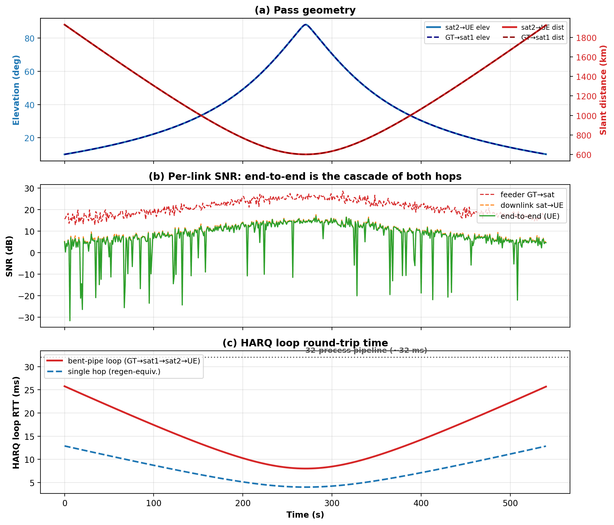
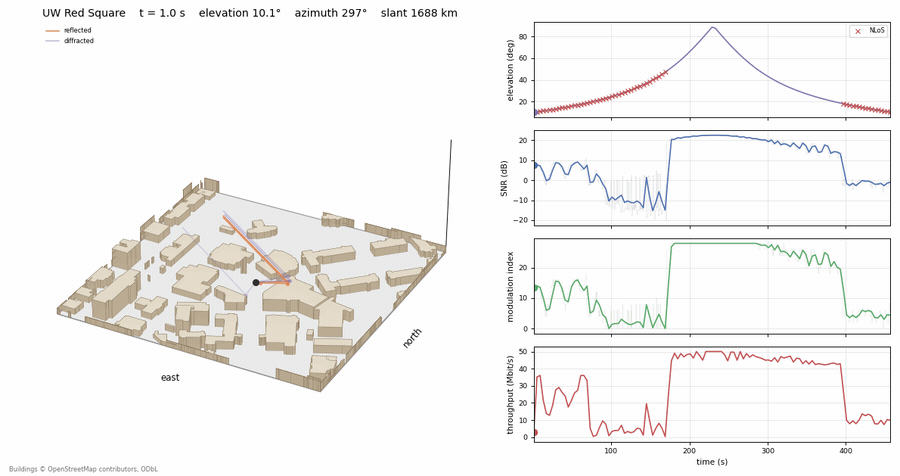
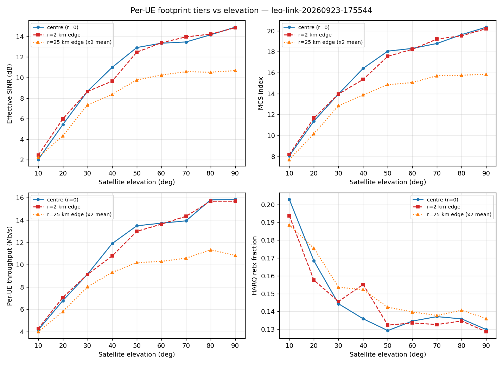
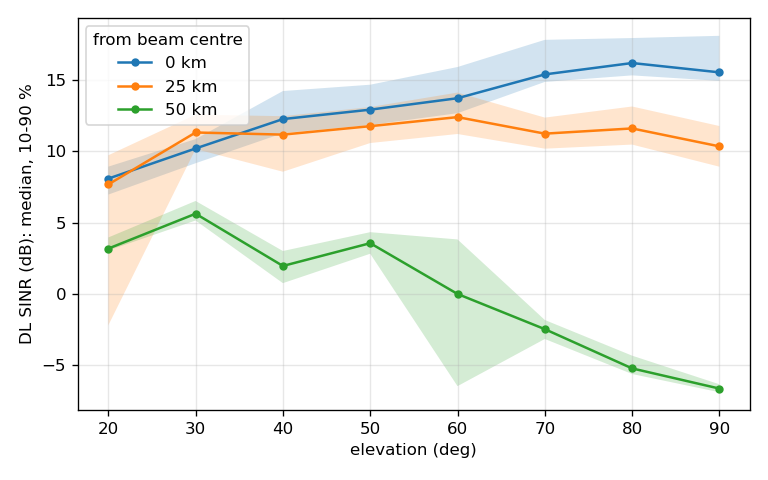
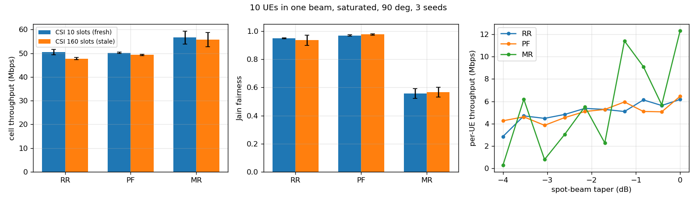
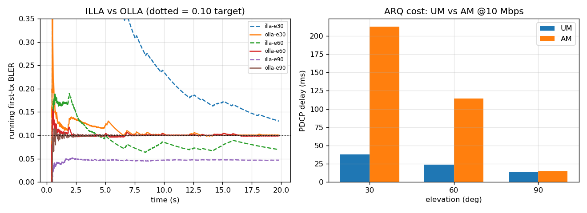
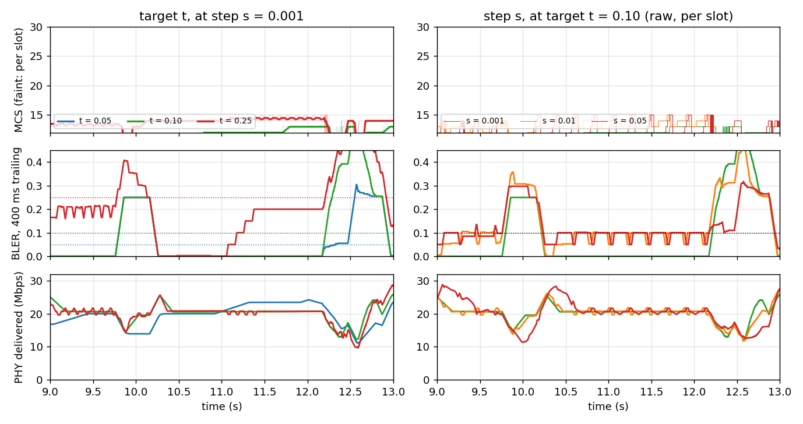
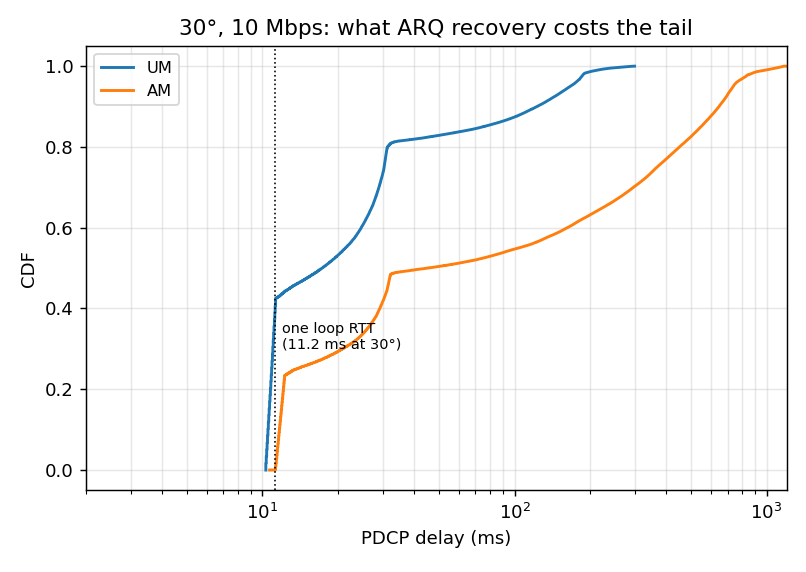
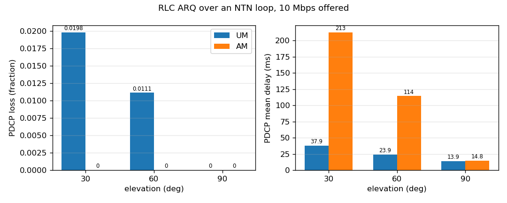

# NTN link adaptation and ARQ — a teaching demo

*Author: Jesse Chiu (Kuan-Po) <kchiu5@uw.edu>*, University of Washington, Seattle

| section | covers |
|---|---|
| [Quick start](#quick-start) | build, run the demo, plot |
| [Link budget presets](#link-budget-presets) | the TR 38.821 cases `--ntnPreset` selects |
| [Example 0 — pre-check, before you simulate](#example-0--pre-check-before-you-simulate) | link budget, delay and throughput ceiling, no simulation |
| [Example 1 — transparent bent-pipe pass](#example-1--transparent-bent-pipe-pass) | the cascaded link and its HARQ loop |
| [Example 2 — ray tracing over the UW campus](#example-2--ray-tracing-over-the-uw-campus) | a ray-traced pass over Red Square, as video |
| [Example 3 — full pass, regenerative, four UEs](#example-3--full-pass-regenerative-four-ues) | a whole pass shared by four UEs |
| [Example 4 — beam edge, UEs at 0, 25 and 50 km](#example-4--beam-edge-ues-at-0-25-and-50-km) | what the spot-beam taper costs away from the beam centre |
| [Example 5 — scheduler: RR, PF and MR under CSI aging](#example-5--scheduler-rr-pf-and-mr-under-csi-aging) | ten UEs, three schedulers, fresh and stale CSI |
| [Example 6 — link adaptation: ILLA and OLLA](#example-6--link-adaptation-illa-and-olla) | what CQI alone gets wrong, and what OLLA corrects |
| [Example 7 — RLC ARQ](#example-7--rlc-arq) | what recovering HARQ residuals costs in delay |
| [Notes](#notes) | numerology and reporting |
| [Configuration reference](#configuration-reference) | every flag of `leo-link` |

All commands run from the ns-3 root that `ntn-patch.sh apply` was pointed at. Output goes to
`results/`. The analysis scripts need `pandas`, `numpy` and `matplotlib`.

`leo-link` runs both payloads, `--payload=transparent` (the default) or `regenerative`, over
any constellation: every satellite carries a gNB and each UE attaches to the closest one.
Several UEs can share the beam (`--numUes`, placed around UE 0 by `--ueRadiiKm`).


## Quick start

```bash
./ns3 configure --enable-examples -d optimized    # needs Eigen3 (libeigen3-dev), or the examples are not built
./ns3 build leo-link

./ntn/scripts/run_ntn_demo.sh results/ntn-demo               # examples 6 and 7: 19 runs, ~25 min
python3 ntn/scripts/summarize_ntn_demo.py results/ntn-demo   # -> summary.csv, ntn-demo.png
```

## Link budget presets

`--ntnPreset` sets the service link to a TR 38.821 calibration case, and the altitude of the
default orbit (600 km, or 1200 km for `sc14handset`/`sc15handset`; `--orbitFile` replaces it).
It is applied before any other flag, so an explicit flag still wins. The scripts in this
folder run on the default preset and override what their parameter files set.

| preset | band | bandwidth | satellite (Set-1) | terminal | 38.821 DL CNR |
|---|---|---|---|---|---|
| `sc9handset` (default) | S, 2 GHz, LEO-600 | 30 MHz | 34 dBW/MHz, 30 dBi, G/T 1.1 dB/K, 4.4127° beam | 0 dBi, NF 7 dB, 23 dBm | 6.6 dB with a 3 dB shadowing margin, so a simulated median of about 9.6 dB |
| `sc14handset` | S, 2 GHz, LEO-1200 | 30 MHz | 40 dBW/MHz, 30 dBi, G/T 1.1 dB/K, 4.4127° beam | 0 dBi, NF 7 dB, 23 dBm | 7.2 dB with a 3 dB shadowing margin |
| `sc15handset` | S, 2 GHz, LEO-1200 | 10 MHz | 40 dBW/MHz, 30 dBi, G/T 1.1 dB/K, 4.4127° beam | 0 dBi, NF 7 dB, 23 dBm | 7.2 dB with a 3 dB shadowing margin |
| `sc6vsat` | Ka, DL 20 / UL 30 GHz, LEO-600 | 400 MHz | 4 dBW/MHz, 38.5 dBi, G/T 13 dB/K, 1.7647° beam | 39.7 dBi, 242 K (NF -0.78 dB), EIRP 76.2 dBm | 8.5 dB |

Every terminal is one element position with two ±45° cross-polarised ports at rank 1. The
satellite's G/T is its receive gain over a noise figure (4.28 dB S-band, 0.88 dB Ka), its beam
sets the spot-beam taper for UEs away from UE 0, and the gNB power is the EIRP minus its gain,
spread over the whole carrier (`NrGnbPhy::PowerAllocationType=UniformPowerAllocBw`) so the EIRP
density holds at any load; LENA's default puts it all on the RBs in use.
Kept apart from TR 38.821 on purpose: NTN-Suburban rather than the Rural, line-of-sight
calibration baseline; the S-band uplink at 1.81 GHz, since the FDD carriers must not overlap;
circular polarisation modelled as cross-polarised ports; one beam, no neighbour interference.
The handheld uplink gets the full carrier, so its 23 dBm is spread over 30 MHz where the TR's
uplink budget assumes 360 kHz, 19 dB less power per hertz.

## Example 0 — pre-check, before you simulate

Link budget, delay and a throughput ceiling from arithmetic, in milliseconds.

**Run**

```bash
./ntn/tools/ntn_precheck.py --preset regen
./ntn/tools/ntn_precheck.py --preset bentpipe
./ntn/tools/ntn_precheck.py --eirp-dbw-mhz 11.4 --bw-mhz 100 --freq-ghz 12 \
        --rx-gain 30 --elev 10 30 60 90 --hops 1
```

| option | meaning | default |
|---|---|---|
| `--preset` | `regen` or `bentpipe` (the latter matches example 1) | — |
| `--eirp-dbw-mhz` | satellite EIRP density | 11.4 |
| `--bw-mhz` | channel bandwidth | 100 |
| `--freq-ghz` | carrier | 12 |
| `--alt-km` | orbit altitude | 600 |
| `--rx-gain` | UE antenna gain (30 VSAT, 0 handheld) | 30 |
| `--noise-fig` | receiver noise figure | 1.2 |
| `--hops` | 1 regenerative, 2 bent-pipe | 1 |
| `--elev` | elevations to evaluate | 10 30 60 90 |
| `--harq-procs` | HARQ processes, for the pipeline check | 32 |

**Output**, regenerative preset:

```
   elev    slant     FSPL     SNR     SE      rate      RTT     HARQ
    deg       km       dB      dB b/s/Hz      Mbps       ms  loop ms
     10     1932    179.7     3.9   1.46     145.9     12.9     14.9
     30     1075    174.7     9.0   2.73     273.2      7.2      9.2
     60      683    170.7    13.0   3.90     390.5      4.6      6.6
     90      600    169.6    14.1   4.26     425.7      4.0      6.0
```

Shannon less 1.5 dB, clamped to MCS 0–28: a ceiling, not a prediction.

## Example 1 — transparent bent-pipe pass

**Setup** — `run_leo_link_bent_pipe_analysis.py` with `params/leo_link_transparent_pass.txt`,
driving `leo-link` (transparent)

| parameter | value | flag |
|---|---|---|
| Path | gateway → satellite → UE, amplify-and-forward | `--payload=transparent` (default) |
| Service link | TR 38.821 study case 9, the default: 2 GHz, 30 MHz, EIRP 34 dBW/MHz, NTN-Suburban, handheld | `--ntnPreset=sc9handset` (default) |
| Feeder | gateway 60 dBm at the UE, satellite Rx 30 dBi | defaults |
| Pass | full, 10° → 90° → 10° | `--observerMode=full-pass --observerElevationBoundaryDeg=10 --duration=600` |
| Traffic | 10 Mbps UDP, 1200 B | `--udpRateMbps=10` |

**Run**

```bash
python3 ntn/scripts/run_leo_link_bent_pipe_analysis.py \
        --param-file ntn/params/leo_link_transparent_pass.txt
```



Per-link SNR for the feeder hop, the service hop and the end-to-end cascade; HARQ loop RTT
against what a 32-process pipeline covers at µ = 0. With the gateway at the UE both hops share
the geometry. The feeder (26 dB at zenith) sits about 11 dB above the service hop (15 dB), so the
cascade follows the service hop; the deep dips are NTN-Suburban's non-line-of-sight draws. The
loop RTT runs 8–26 ms against 4–13 ms for a single hop, inside the 32-process pipeline.
Render with `plot_bentpipe_pass_3panel.py <run> --output bentpipe-pass.png --min-elev 10`.

## Example 2 — ray tracing over the UW campus

`leo-link-regen-RT` replaces the statistical channel with Sionna RT ray tracing, here over a scene
of the University of Washington campus: 178 buildings from OpenStreetMap around Red Square. The
satellite is a proxy transmitter 10 km out along the true line of sight; delay and the remaining
range loss come from the true geometry. Sionna setup: [`SIONNA.md`](SIONNA.md).

**Setup**

| parameter | value | flag |
|---|---|---|
| Scene | UW campus, 178 concrete buildings on brick ground | `--sionnaScene=ntn/data/uw-campus/scene.xml` |
| Terminal | Red Square, 1.5 m, at the scene origin | `--sionnaTerminal=0:0:1.5 --observerLatDeg=47.6560453 --observerLonDeg=-122.3094075` |
| Orbit | one satellite, 500 km, 53° | `--orbitFile=ntn/data/orbit-500km-53deg.csv` |
| Pass | directly over Red Square, southbound, 10° → 90° → 10°, 461 s; rises in the WNW, sets in the ESE | `ntn/tools/aim_pass.py --southbound` → `--satLongitudeDeg --satArgOfLatitudeDeg --duration` |
| Ray-tracing update | every 1 s | `--precision=1000` |
| Ray tracing | up to 2 bounces: direct, reflected, through-wall, diffracted; 10^8 rays per update | `--sionnaDiffraction=1 --sionnaSamplesPerSource=100000000` (defaults) |
| Satellite antenna | one element per polarisation, vertical + horizontal; the spot beam's gain is inside the EIRP | `--gnbAntennaRows=1 --gnbAntennaColumns=1` (defaults) |
| Link budget | TR 38.821 study case 9, given explicitly since this example has no presets: 2 GHz, 30 MHz, EIRP 34 dBW/MHz, Set-1 satellite antenna 30 dBi and G/T 1.1 dB/K (a 4.28 dB noise figure) | `--dlFrequencyHz=2e9 --bandwidthHz=30e6 --satEIRP=34 --satAntennaGainDb=30 --ns3::NrGnbPhy::NoiseFigure=4.28` |
| Terminal | the study case's handheld: one element, two ±45° ports, 0 dBi, 7 dB noise figure | `--ueIsDualPolarized=1 --uePolSlantAngleDeg=45 --vsatAntennaGainDb=0 --ns3::NrUePhy::NoiseFigure=7` |
| MIMO | off, rank 1 | `--enableMimoFeedback=0 --rankLimit=1` |
| HARQ | on, 32 processes | `--enableHarqReTx=1 --numHarqProcess=32` |
| Traffic | 40 Mbps UDP | `--udpRateMbps=40` |

**Run** — about 21 minutes to simulate, seconds each for the line-of-sight table and the paths,
1 minute to render

```bash
export PYTHONPATH=/path/to/sionna-venv/lib/python3.12/site-packages   # for ns-3 only, which embeds the system Python; see SIONNA.md
# The analysis scripts below run on the venv's own Python: system python3 with this PYTHONPATH
# mixes two matplotlib installs and fails to import mpl_toolkits.
mkdir -p results/uw-pass
AIM=$(./ntn/tools/aim_pass.py --lat 47.6560453 --lon -122.3094075 --alt-km 500 --incl-deg 53 --southbound)
./ns3 run "leo-link-regen-RT --orbitFile=$PWD/ntn/data/orbit-500km-53deg.csv \
    --observerMode=full-pass --observerElevationBoundaryDeg=10 $AIM --precision=1000 \
    --sionnaScene=$PWD/ntn/data/uw-campus/scene.xml --sionnaTerminal=0:0:1.5 \
    --dlFrequencyHz=2e9 --bandwidthHz=30e6 --satEIRP=34 --satAntennaGainDb=30 \
    --ns3::NrGnbPhy::NoiseFigure=4.28 \
    --vsatAntennaGainDb=0 --ueIsDualPolarized=1 --uePolSlantAngleDeg=45 \
    --ns3::NrUePhy::NoiseFigure=7 --enableMimoFeedback=0 --rankLimit=1 --enableHarqReTx=1 \
    --numHarqProcess=32 --udpRateMbps=40 --traceFile=geom.csv" \
    --cwd=results/uw-pass > results/uw-pass/run.log 2>&1
/path/to/sionna-venv/bin/python ntn/scripts/ntn-sionna-cir.py --geom results/uw-pass/geom.csv \
    --run-log results/uw-pass/run.log --scene ntn/data/uw-campus/scene.xml \
    --terminal 0:0:1.5 --frequency 2e9 --los-only --out results/uw-pass   # -> los.csv
/path/to/sionna-venv/bin/python ntn/scripts/ntn-sionna-cir.py --geom results/uw-pass/geom.csv \
    --run-log results/uw-pass/run.log --scene ntn/data/uw-campus/scene.xml \
    --terminal 0:0:1.5 --frequency 2e9 --max-depth 2 --samples-per-src 100000000 --stride 4 \
    --save-paths 12 --out results/uw-pass                         # -> hybrid-cir.json
/path/to/sionna-venv/bin/python ntn/scripts/ntn-rt-render.py --dir results/uw-pass --stride 4 --fps 12 --view-elev 30 \
    --buildings ntn/data/uw-campus-buildings.geojson --place "UW Red Square" \
    --los los.csv --paths hybrid-cir.json --out uw-pass.gif
```



The top panel is elevation against time, with an X wherever the direct ray is blocked (51% of
the pass). In the scene the red line is the direct ray, drawn only while it is unblocked; the other
lines are the traced paths that reach the terminal, coloured by what they last hit (reflected,
diffracted, through a wall), fainter when weaker, down to 40 dB below the strongest.

Rising in the west-northwest, a 42 m windowless brick tower 36 m from the terminal (OSM way
445398676) blocks the direct ray from 10° to 48°. Up to about 17° a reflection carries the link at
about 7 dB and 25 Mbps. From 17° to 48° only weaker indirect paths remain: −9 dB median, 1.6 Mbps,
and 12 s without a delivered block. From 48° through the zenith to 18° the line of sight is clear:
20–22 dB and the full 40 Mbps high in the sky, easing to 14 dB by 18°. Setting in the
east-southeast, Suzzallo Library blocks the direct ray below 18°, and the link holds about −1 dB
and 9 Mbps to the end of the pass. The terminal receives 1476 MB. The buildings drawn are the ones
the rays were traced against.
Buildings © OpenStreetMap contributors, ODbL.

**Other sites.** `ntn/tools/osm_to_sionna.py` turns a GeoJSON of OpenStreetMap footprints with a
`height_m` property into a scene; `ntn/data/uw-campus-buildings.geojson` came from one Overpass
query. Built-in Sionna scenes (`munich`, `san_francisco`, `etoile`, `florence`) also work. Stand
the terminal in the open: under a roof every path is blocked, the received power is zero, and the
run delivers nothing without an error. [`SIONNA.md`](SIONNA.md) describes how to check a spot.

`rt-animate.py` pairs `--sionnaRender` scene images with a metric trace by index, and
`ntn-sionna-cir.py` computes the same hybrid channel offline.

## Example 3 — full pass, regenerative, four UEs

**Setup** — `run_leo_link_analysis.py` with `params/leo_link_full_pass_4ue.txt`, driving `leo-link`
(regenerative)

| parameter | value | flag |
|---|---|---|
| Payload | regenerative, gNB on board | `--payload=regenerative` |
| Link budget | TR 38.821 study case 9 with its Set-1 S-band beam (4.4127°), the default | `--ntnPreset=sc9handset` (default) |
| Pass | 10° → 90° → 10°, live geometry | `--observerMode=full-pass --observerElevationBoundaryDeg=10 --duration=600` |
| UEs | beam centre, 2 km, and two at the 25 km beam edge | `--numUes=4 --ueRadiiKm=0,2,25,25` |
| Traffic | backlogged UDP, 1200 B | `--udpRateMbps=-1` |
| HARQ | 32 processes | `--enableHarqReTx=1 --numHarqProcess=32` |
| RLC | UM, 300 ms reordering | `--rlcReorderingTimerMs=300` |

**Run** — about 12 hours: four backlogged UEs over a 541 s pass

```bash
python3 ntn/scripts/run_leo_link_analysis.py --param-file ntn/params/leo_link_full_pass_4ue.txt
python3 ntn/scripts/analyze_footprint_per_ue.py results/<run> --arch regen   # -> fig_footprint_per_ue.png
```



Binned by satellite elevation over the whole pass, rising and setting together. The centre UEs
climb from 2 dB at 10° to 15 dB at zenith, and MCS from 8 to 20. The two UEs on the 25 km beam
edge level off at about 10.6 dB and MCS 16 above 60°: the higher the satellite, the narrower its
beam on the ground. The four share the carrier, backlogged: each centre UE gets 4 Mbps at 10° and
16 at zenith, each edge UE 11. Over the 541 s pass that is 8.6 ± 1.0 Mbps per UE (9.5 at the
centre, 7.7 at the edge) and 34.2 Mbps for the cell. HARQ retransmits 20 % of blocks at 10°,
13 % above 50°.

## Example 4 — beam edge, UEs at 0, 25 and 50 km

**Setup** — `run_ntn_beam_edge.sh` driving `leo-link` (regenerative)

| parameter | value | flag |
|---|---|---|
| Payload | regenerative | `--payload=regenerative` |
| Link budget | TR 38.821 study case 9, the default: 2 GHz, 30 MHz, EIRP 34 dBW/MHz, NTN-Suburban, handheld | `--ntnPreset=sc9handset` (default) |
| Beam | the study case's Set-1 S-band beam: Airy (TR 38.811 §6.4.1), 4.4127° HPBW, 50 km across at nadir; pattern floor 30 dB | `--beamHpbwDeg=4.4127`, `--beamMaxAttenDb=30` (default) |
| UEs | beam centre, 25 km, 50 km | `--numUes=3 --ueRadiiKm=0,25,50` |
| Elevation | 20° to 90° in 10° steps, one frozen 3 s run each | `--observerMode=full-pass --observerElevationBoundaryDeg={20..80}` or `--observerMode=overhead`, `--freezeGeometry=1` |
| Traffic | 10 Mbps UDP per UE | default |
| HARQ | 32 processes | `--enableHarqReTx=1 --numHarqProcess=32` |

**Partly outside the operating region.** At zenith the 25 km UE sits on the beam's −3.6 dB edge,
where deployed constellations hand a UE to the next beam, and the 50 km UE at −21.7 dB, near the
pattern's first null. The point is to make the beam pattern visible. The sweep starts at 20°: the
other UEs see the satellite lower than UE 0, and the 3GPP NTN channel stops at 10°.

**Run**

```bash
NTN_JOBS=8 ./ntn/scripts/run_ntn_beam_edge.sh results/ntn-beam-edge   # 8 runs, in parallel
python3 ntn/scripts/plot_ntn_beam_edge.py results/ntn-beam-edge      # -> beam-edge-sinr.png
```



Median DL SINR, with the 10-90 % band. The centre UE rises from 8.1 dB at 20° to 16.2 dB at 80°
as the slant range shrinks. The 25 km UE stays at 10–12 dB above 30°: the beam's footprint
shrinks as the satellite climbs, and its taper eats the gain in range. The 50 km UE falls from
5.6 dB at 30° toward the pattern null, −6.6 dB at zenith; at 80° and 90° it loses the link near
the end of the run and re-attaches, a tail the plot leaves out.

## Example 5 — scheduler: RR, PF and MR under CSI aging

**Setup** — `run_ntn_sched10.sh` driving `leo-link` (regenerative)

| parameter | value | flag |
|---|---|---|
| Payload | regenerative | `--payload=regenerative` |
| Link budget | TR 38.821 study case 9, the default: 2 GHz, 30 MHz, EIRP 34 dBW/MHz, NTN-Suburban, handheld | `--ntnPreset=sc9handset` (default) |
| Elevation | 90°, frozen | `--observerMode=overhead --freezeGeometry=1` |
| UEs | 10, uniform in area out to the −4 dB contour: 0, 8.8, 12.4, 15.2, 17.6, 19.7, 21.6, 23.3, 24.9, 26.4 km, azimuths 0…324° in 36° steps | `--numUes=10 --ueRadiiKm=... --ueAzimuthsDeg=...` |
| Beam | the study case's Set-1 S-band beam, 4.4127° HPBW; −4 dB contour at 26.4 km | `--beamHpbwDeg=4.4127` |
| Traffic | 12 Mbps per UE, saturating the cell; 60 s, 3 seeds | `--udpRateMbps=12 --duration=60 --RngRun={1,2,3}` |
| CSI aging | CSI-RS every 10 slots (fresh) or 160 (stale) | `--ns3::NrHelper::CsiFeedbackFlags=6 --ns3::NrGnbPhy::CsiRsPeriodicity={10,160}` |
| Schedulers | RR, PF, MR | `--scheduler=ns3::NrMacSchedulerOfdma{RR,PF,MR}` |
| Link adaptation | OLLA, step 0.001, target 0.10 | `--ollaStepUp=0.001 --ollaTargetBler=0.1` |
| HARQ | 32 processes, timeout 100 | `--numHarqProcess=32 --ns3::NrMacSchedulerNs3::HarqProcessTimeout=100` |
| Error model | EESM-IR table 1, on AMC and PHY | `--ns3::NrAmc::ErrorModelType=ns3::NrEesmIrT1`, same for `NrSpectrumPhy` |

`CsiFeedbackFlags=6` turns on CSI-RS and CSI-IM; without it `CsiRsPeriodicity` does nothing.
All ten UEs start random access in the same slot and the gNB fits only a few Msg3 grants per slot:
30 MHz fits all ten, 10 MHz only six, and with the ideal random access (`--idealRa`, on by default)
an unanswered preamble is never retried.

**Run**

```bash
NTN_JOBS=18 ./ntn/scripts/run_ntn_sched10.sh results/ntn-sched10   # 18 runs, in parallel
python3 ntn/scripts/plot_ntn_sched.py results/ntn-sched10          # -> sched.png
```



Mean over 3 seeds, bars ±1 std. Left: cell throughput. MR reaches 56.6 Mbps with fresh CSI
against 50.5 for RR and 50.2 for PF. Middle: Jain fairness, 0.95 for RR, 0.97 for PF, 0.56 for
MR. Right: per-UE throughput against the UE's beam taper, fresh CSI. PF and RR keep every UE
between 2.8 and 6.5 Mbps; MR spreads them from 0.3 to 12.3 Mbps and starves one edge UE in one
seed. Aging the CSI from 10 to 160 slots costs RR 2.8 Mbps and PF and MR under 1: with the UEs
and the satellite frozen, the channel hardly changes in 160 ms.

## Example 6 — link adaptation: ILLA and OLLA

**Setup** — `run_ntn_demo.sh` driving `leo-link` (transparent), shared with example 7

| parameter | value | flag |
|---|---|---|
| Link budget | TR 38.821 study case 9, the default: S-band 2 GHz, 30 MHz, µ = 0 (1 slot = 1 ms), EIRP 34 dBW/MHz, NTN-Suburban, handheld (one element, two ±45° ports, 0 dBi, 7 dB noise figure) | `--ntnPreset=sc9handset` (default) |
| Gateway | at the UE | default |
| Elevation | 30°, 60°, 90°, held fixed | `--freezeGeometry=1`, with `--observerMode=full-pass --observerElevationBoundaryDeg={30,60}` or `--observerMode=overhead` |
| UE | one, at beam centre | `--numUes=1 --ueRadiiKm=0` |
| Traffic | 20 Mbps UDP, 20 s, seed 1; one UE carries 18 Mbps at 30°, 64 at 60°, 68 at 90° | `--udpRateMbps=20 --duration=20 --RngRun=1` |
| Scheduler | OFDMA round-robin | `--scheduler=ns3::NrMacSchedulerOfdmaRR` |
| Error model | EESM-IR table 1, on AMC **and** PHY | `--ns3::NrAmc::ErrorModelType=ns3::NrEesmIrT1`, same for `NrSpectrumPhy` |
| HARQ | 32 processes, timeout 100 | `--numHarqProcess=32 --ns3::NrMacSchedulerNs3::HarqProcessTimeout=100` |
| ILLA runs | outer loop off | `--ollaStepUp=0` |
| OLLA runs | step 0.01, target 0.10; `ollaslow-e30` uses step 0.001 | `--ollaStepUp=0.01 --ollaTargetBler=0.1` |
| Knob sweep, 30° | target 0.05 and 0.25 at step 0.001; step 0.05 at target 0.10 | runs `t005`, `t025`, `s05` |

**Run**

```bash
NTN_JOBS=19 ./ntn/scripts/run_ntn_demo.sh results/ntn-demo   # 19 runs, in parallel
python3 ntn/scripts/summarize_ntn_demo.py results/ntn-demo   # -> ntn-demo.png
python3 ntn/scripts/plot_ntn_demo_figures.py results/ntn-demo # -> v1-tbler.png
```



Left: first-transmission BLER, ILLA vs OLLA per elevation. OLLA holds 0.10 at every elevation;
ILLA ends at 0.05 at 90° and 0.07 at 60° but 0.13 at 30°. Right: PDCP delay, RLC UM vs AM
(example 7).



Left column varies the target at step 0.001; right column varies the step at target 0.10.
Rows: MCS, first-transmission BLER, PHY rate.

## Example 7 — RLC ARQ

**Setup** — the example 6 runs, with RLC varied

| parameter | value | flag |
|---|---|---|
| RLC mode | UM or AM | `--rlcMode={um,am}` |
| AM uplink | ideal, so STATUS PDUs decode | `--perfectUplink=1` |
| Load | 20 Mbps for `am-e*`, 10 Mbps for the `lo-um-e*` / `lo-am-e*` pair | `--udpRateMbps={20,10}` |
| Everything else | as example 6 | — |

**Run**

```bash
./ntn/scripts/run_ntn_demo.sh results/ntn-demo
python3 ntn/scripts/plot_v2_arq.py results/ntn-demo          # -> v2-arq.png, shown as v2-pdcp.png
python3 ntn/scripts/plot_ntn_demo_figures.py results/ntn-demo # -> v2-delay-e30.png
```



PDCP delay CDF at 30°, 10 Mbps, half of what the link carries. AM delivers everything, where UM
loses 2.0 %; the price is delay, 213 ms mean against 38 ms. The dotted line is one loop RTT.



PDCP loss and mean delay at 30°, 60° and 90°. AM loses nothing; UM loses 2.0 % at 30°, 1.1 % at
60° and nothing at 90°. The AM delay penalty falls from +175 ms at 30° to +91 ms at 60° and
+1 ms at 90°.

## Notes

- **µ = 0 is not 3GPP-compliant above about 50 MHz.** At 15 kHz spacing, 100 MHz needs 555
  PRBs and 250 MHz 1333, against the NR maximum of 275. The runs keep µ = 0 so one slot is one
  millisecond; state the spacing and PRB count in any write-up.
- **Report throughput as mean per-UE ± std**, and say whether a figure is per-UE or aggregate.

## Configuration reference

Every command-line flag of `leo-link`, generated from `--PrintHelp` on the built binary, so the
defaults are the ones the binary uses. Note that these are the defaults **after** `--ntnPreset`
is applied: the preset runs before the flags are registered, so the table reflects `sc9handset`
unless you pass another `--ntnPreset`.

| flag | default | meaning |
|---|---|---|
| `--ntnPreset` | `sc9handset` | 3GPP TR 38.821 calibration preset for the service link and the default orbit: sc9handset (LEO-600 handheld, the default), sc14handset or sc15handset (LEO-1200 handheld, 30 or 10 MHz) or sc6vsat (LEO-600 VSAT) |
| `--payload` | `transparent` | Satellite payload: transparent (amplify-and-forward relay, the waveform also crosses the feeder link from the gateway) or regenerative (the gNB terminates NR on the satellite) |
| `--orbitFile` | `` | CSV file with orbit parameters in the ns-3.48 format (header line, then altitudeKm,inclinationDegrees,numberOfPlanes,numberOfSatellitesPerPlane[,phasing,raanSpanDeg] per row). Every satellite carries a gNB. Default: one satellite at the --ntnPreset altitude |
| `--traceFile` | `` | Colon-separated satellite geometry trace (Time:Satellite:x:y:z:x_2:y_2:z_2:elevation_deg:slant_distance_m), one row per satellite every --precision |
| `--linkBudgetTraceFile` | `` | Tab-separated link budget of UE 0 through the first satellite, every --precision |
| `--channelConditionTraceFile` | `` | Text file to store the 3GPP LOS/NLOS condition of the first satellite -> UE 0 |
| `--scenario` | `NTN-Suburban` | 3GPP NTN scenario of the service link |
| `--precision` | `1000` | Mobility resolution in milliseconds: the period of the orbit model's CourseChange notifications, of the traces, of the satellite antenna re-pointing and (with --channelUpdateMs=0) of the channel regeneration. The satellite position itself is continuous in time. |
| `--channelUpdateMs` | `0` | 3GPP channel and channel-condition regeneration period in ms, independent of the orbit step. 0 follows --precision |
| `--duration` | `4` | Duration of the simulation in seconds |
| `--dlFrequencyHz` | `2e+09` | Downlink carrier centre frequency in Hz (BWP 0) |
| `--ulFrequencyHz` | `0` | Uplink carrier centre frequency in Hz (BWP 1); 0 derives dlFrequencyHz - 190 MHz |
| `--bandwidthHz` | `3e+07` | Channel bandwidth in Hz of each FDD carrier |
| `--satEIRP` | `34` | Satellite EIRP density in dBW/MHz |
| `--satAntennaGainDb` | `30` | Satellite (gNB) element gain in dBi: the gNB transmits the EIRP minus this gain, and the gain also closes the uplink |
| `--ueTxPowerDbm` | `23` | UE Tx power in dBm |
| `--gatewayTxPowerDbm` | `60` | Gateway transmit power on the feeder link in dBm (transparent) |
| `--satFeederRxGainDb` | `30` | Satellite receive antenna gain on the feeder link in dBi (transparent) |
| `--relayLossDb` | `0` | Loss between the relay's receive antenna and its amplifier in dB (transparent) |
| `--gatewayLatDeg` | `nan` | Gateway latitude in degrees (transparent); with --gatewayLonDeg. Default: UE 0 |
| `--gatewayLonDeg` | `nan` | Gateway longitude in degrees (transparent) |
| `--receiverNfDb` | `5` | Receiver noise figure in dB, applied at every node whose --ueNoiseFigureDb / --gnbNoiseFigureDb is unset; the transparent feeder model charges the relay noise against the UE figure too |
| `--relayProcessingDelayUs` | `0` | Processing delay of the transparent relay satellite in us |
| `--remoteHostDelayMs` | `0` | RemoteHost-to-PGW one-way delay in ms |
| `--s1uLinkDelayMs` | `0` | S1-U backhaul one-way delay in ms |
| `--transport` | `udp` | Application transport: tcp or udp |
| `--udpRateMbps` | `10` | Per-UE UDP offered load in Mbps; <= 0 keeps the downlink backlogged |
| `--udpPacketSize` | `1200` | Application payload size in bytes |
| `--beamUpdateMs` | `100` | Beam-pointing refresh period in ms (ideal beamforming and spot-beam taper) |
| `--consolidateHarqRetx` | `true` | Reshape HARQ retransmission DCIs so they share symbols with new transmissions instead of forming a separate time-multiplexed group |
| `--ollaStepUp` | `0.01` | DL outer-loop link adaptation step on ACK, in MCS units. 0 disables OLLA |
| `--ollaTargetBler` | `0.15` | Target initial (first-transmission) BLER for DL OLLA |
| `--dlHarqFeedbackDisabled` | `false` | Rel-17 NTN: release the DL HARQ process at transmission instead of on feedback. No retransmissions; reliability must come from RLC AM |
| `--rlcMode` | `um` | RLC mode for data bearers: um or am |
| `--rlcAmPollRetxMs` | `25` | RLC AM t-PollRetransmit in ms |
| `--rlcAmReorderingMs` | `40` | RLC AM t-Reordering in ms |
| `--rlcAmStatusProhibitMs` | `10` | RLC AM t-StatusProhibit in ms |
| `--rlcAmRetxAlwaysFits` | `false` | RLC AM TxOpportunityForRetxAlwaysBigEnough; true sends a retransmission whole even when it overflows the grant, false re-segments it |
| `--ueAntennaElementGainDbi` | `0` | Flat gain in dBi applied to each UE antenna element. With a 1x1 array this models a dish of that boresight gain directly (published study value: 34.6 dBi). |
| `--ueAntennaElement` | `isotropic` | UE antenna element pattern: 'isotropic', or '3gpp' for the TR 38.901 element with 8 dBi peak. A VSAT dish needs the directional element -- reaching 34.6 dBi with isotropic elements would take ~2600 of them instead of ~420. |
| `--ueNoiseFigureDb` | `7` | UE receiver noise figure in dB referenced to T0=290K, i.e. 10log10(Tsys/290). A representative Ku-band VSAT assumption is -2.3 dB (Tsys ~170 K: 1.5 dB LNB plus cold sky). Unset keeps the ns-3 default of 5 dB. |
| `--gnbNoiseFigureDb` | `4.28` | gNB/satellite receiver noise figure in dB referenced to T0=290K. A satellite sees the warm Earth, so ~7 dB (Tsys ~1453 K). Unset keeps the ns-3 default. |
| `--perfectUplink` | `false` | Disable the gNB data error model so every UL TB decodes. With a weak uplink budget RLC AM STATUS PDUs are otherwise lost and the AM window never advances. Diagnostic only. |
| `--ollaMaxOffset` | `12` | Clamp on the DL OLLA offset in MCS units. A run that spends time clamped is measuring the clamp rather than the step size |
| `--useFixedMcs` | `false` | Use fixed MCS in scheduler for DL/UL |
| `--fixedMcs` | `4` | Fixed MCS index to use when --useFixedMcs=1 |
| `--enableHarqReTx` | `true` | Enable HARQ retransmissions in the scheduler |
| `--numHarqProcess` | `16` | Number of HARQ processes per UE. With --ntnTiming a process is kept for numHarqProcess + K_offset slots; without it the pool must cover the loop RTT in slots on its own. |
| `--lbrm` | `false` | Limited-buffer rate matching (TS 38.212 5.4.2.1): bound HARQ-IR combining to the soft buffer of one transport block, about 1.5 x TBS_LBRM, where TBS_LBRM is the largest block this carrier supports (highest MCS, rankLimit, every RB). Ncb has no HARQ-process term in NR, so the buffer does not depend on numHarqProcess. Needs a HARQ-IR error model (NrEesmIrT1/T2); off leaves the buffer unlimited. |
| `--n1Delay` | `2` | UE processing delay in slots for DL HARQ feedback (0-4); not a propagation substitute. |
| `--n2Delay` | `2` | Slots between UL grant and UL transmission (0-4) |
| `--rlcReorderingTimerMs` | `100` | NrRlcUm t-Reordering in ms. Must exceed worst-case multi-retx HARQ delay. |
| `--numUes` | `1` | Number of UEs sharing the beam |
| `--ueSpacingDeg` | `0.05` | Geographic latitude offset in degrees between successive UEs, spreading them across the beam footprint |
| `--footprintRadiusKm` | `0` | Beam footprint radius in km (>0 enables centre/edge placement + spot-beam gain taper: 0 dB at centre, -3 dB at the footprint edge). 0 disables (uses ueSpacingDeg). |
| `--beamHpbwDeg` | `4.4127` | Half-power beamwidth (deg) of a geometry-driven spot-beam taper G(theta)=-min(12*(theta/HPBW)^2, beamMaxAttenDb); 0 disables (static r/R taper) |
| `--beamMaxAttenDb` | `30` | Max spot-beam pattern attenuation (dB) |
| `--ueAzimuthsDeg` | `` | Comma-separated per-UE bearing in degrees clockwise from north (one per UE after UE 0). Combined with --ueRadiiKm this places UEs on a ring at equal radius. Empty keeps the latitude-only spread |
| `--freezeGeometry` | `false` | Hold the satellites at their initial positions: static geometry, constant elevation and delay. Use with --ueSpeedMps for a terrestrial analogue |
| `--ueSpeedMps` | `0` | UE ground speed in m/s (0 = stationary) |
| `--ueHeadingDeg` | `0` | UE heading in degrees clockwise from north |
| `--ueRadiiKm` | `` | Comma-separated per-UE radial distances from beam centre in km (e.g. 0,30,30,50); overrides the 2-centre+edge auto-placement |
| `--scheduler` | `ns3::NrMacSchedulerTdmaRR` | MAC scheduler TypeId (e.g. ns3::NrMacSchedulerTdmaRR or ns3::NrMacSchedulerOfdmaRR) |
| `--observerMode` | `overhead` | Observer placement mode: overhead or full-pass |
| `--observerElevationBoundaryDeg` | `10` | Elevation boundary in degrees: full-pass mode starts UE 0 where the first satellite rises through it, and the run stops when the satellite descends through it |
| `--observerLatDeg` | `nan` | UE 0 latitude in degrees; with --observerLonDeg, overrides --observerMode |
| `--observerLonDeg` | `nan` | UE 0 longitude in degrees |
| `--satLongitudeDeg` | `nan` | Starting longitude of the first satellite's orbital plane, degrees; with --satArgOfLatitudeDeg this sets where the pass goes (see ntn/tools/aim_pass.py) |
| `--satArgOfLatitudeDeg` | `nan` | Starting argument of latitude of the first satellite, degrees |
| `--ntnTiming` | `true` | Derive NrGnbPhy::CellSpecificKoffset, the per-UE NrUePhy::TimingAdvance and NrGnbRrc::ConnectionRequestTimeoutDuration from the geometry of the run. 0 leaves all three at their defaults (the like-for-like arm). |
| `--idealRa` | `true` | NrUeMac::IdealRandomAccess: never arm the RA response timeout, and pin the RRC connection-request timer to its 2000 ms ceiling |
| `--enableMimoFeedback` | `true` | Enable DL MIMO CQI/RI/PMI feedback |
| `--pmSearchMethod` | `ns3::NrPmSearchFull` | MIMO precoding matrix search TypeId |
| `--fullSearchCb` | `ns3::NrCbTwoPort` | Codebook TypeId for full-search PMI |
| `--rankLimit` | `1` | Maximum MIMO rank to use |
| `--rankThreshold` | `0` | Rank selection threshold |
| `--rankTechnique` | `Sasaoka` | Rank selection technique |
| `--subbandSize` | `32` | Subband size in PRBs for MIMO PMI search |
| `--downsamplingTechnique` | `FirstPRB` | Subband downsampling technique |
| `--ueAntennaRows` | `1` | UE antenna array rows |
| `--ueAntennaColumns` | `1` | UE antenna array columns |
| `--ueNumVerticalPorts` | `1` | UE vertical antenna ports |
| `--ueNumHorizontalPorts` | `1` | UE horizontal antenna ports |
| `--gnbAntennaRows` | `1` | gNB antenna array rows |
| `--gnbAntennaColumns` | `1` | gNB antenna array columns |
| `--gnbNumVerticalPorts` | `1` | gNB vertical antenna ports |
| `--gnbNumHorizontalPorts` | `1` | gNB horizontal antenna ports |
| `--ueIsDualPolarized` | `true` | Enable dual-polarized UE antenna elements |
| `--gnbIsDualPolarized` | `true` | Enable dual-polarized gNB antenna elements |
| `--uePolSlantAngleDeg` | `45` | UE polarization slant angle in degrees |
| `--gnbPolSlantAngleDeg` | `0` | gNB polarization slant angle in degrees |
| `--PrintGlobals` | `` | Print the list of globals. |
| `--PrintGroups` | `` | Print the list of groups. |
| `--PrintGroup=[group]` | `` | Print all TypeIds of group. |
| `--PrintTypeIds` | `` | Print all TypeIds. |
| `--PrintAttributes=[typeid]` | `` | Print all attributes of typeid. |
| `--PrintVersion` | `` | Print the ns-3 version. |
| `--PrintHelp` | `` | Print this help message. |
